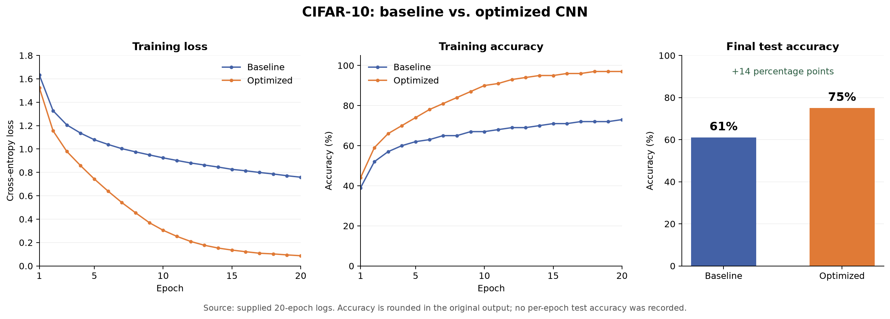
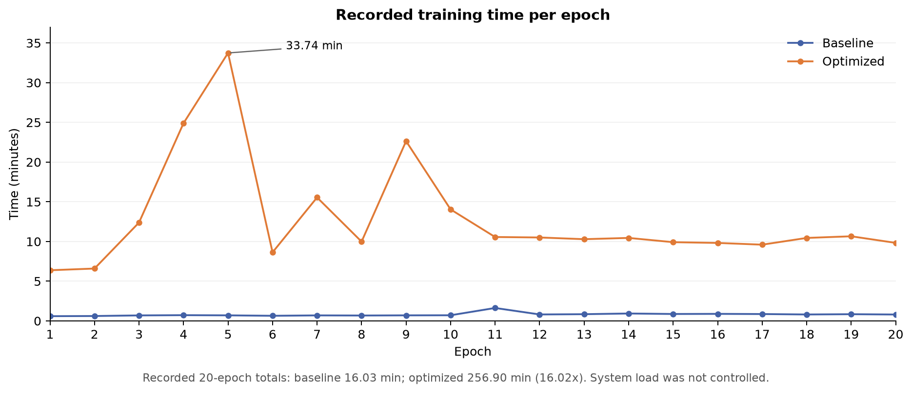
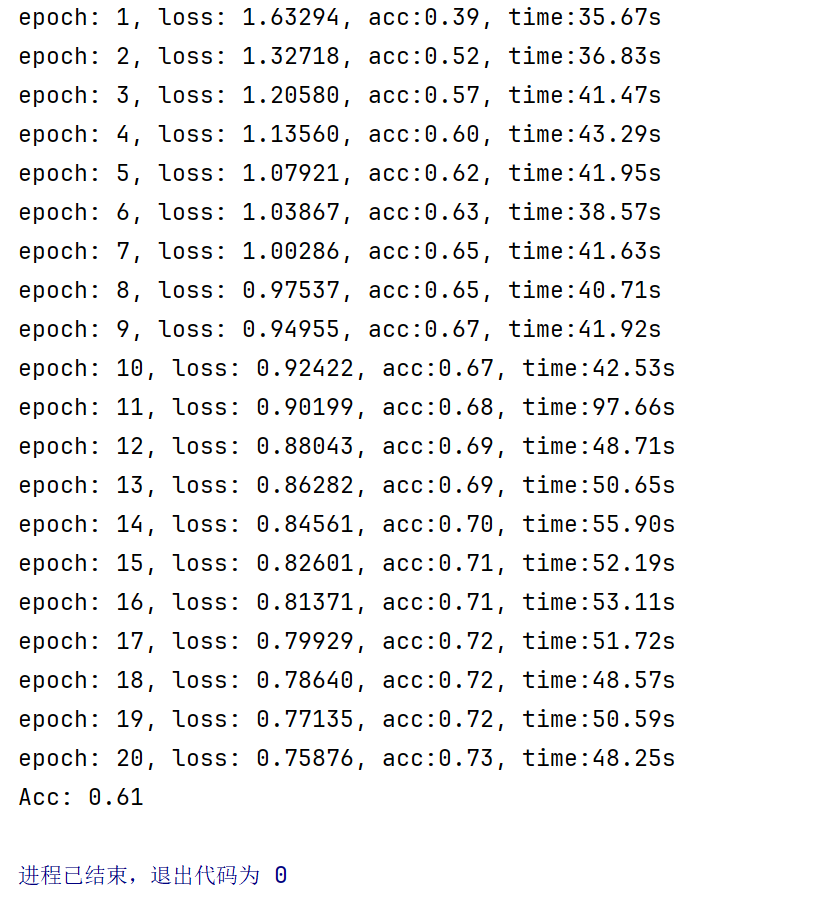
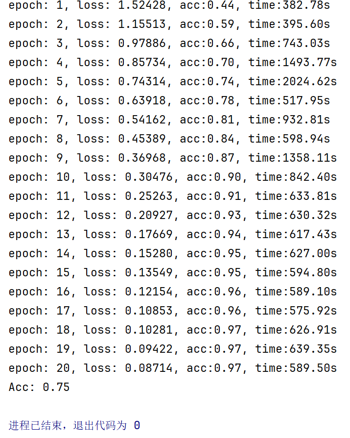

# 基于 **PyTorch** 的 CIFAR-10 图像分类

本项目用一个两层卷积神经网络完成 CIFAR-10 十分类，并比较基础模型与优化模型在相同训练轮数下的表现。训练 20 轮后，测试准确率从约 **61% 提升到 75%**。两次实验的训练时间分别约为 **16 分钟**和 **4 小时 17 分钟**。

## 目录

1. [实验目标与数据集](#1-实验目标与数据集)
2. [项目结构与运行方法](#2-项目结构与运行方法)
3. [模型结构与参数量](#3-模型结构与参数量)
4. [四项优化及其作用](#4-四项优化及其作用)
5. [训练流程与指标](#5-训练流程与指标)
6. [实验结果与对比图](#6-实验结果与对比图)
7. [逐轮数据与原始截图](#7-逐轮数据与原始截图)
8. [实验总结与后续验证](#8-实验总结与后续验证)

## 1. 实验目标与数据集

一张 32 × 32 像素的彩色图片中可能出现飞机、汽车、鸟、猫、鹿、狗、青蛙、马、船或卡车。模型接收这张图片，为十个类别各输出一个分数，并以分数最高的类别作为预测结果。本实验关注两个问题：在相同的训练轮数下，扩大网络后能多分对多少测试图像？这种提升需要增加多少参数和训练时间？

| 数据 | 样本数 | 在实验中的用途 |
| --- | ---: | --- |
| 训练集 | 50,000 张，每类 5,000 张 | 计算损失、更新权重，按轮统计训练指标 |
| 测试集 | 10,000 张，每类 1,000 张 | 训练结束后评估最终权重 |

训练集和测试集都使用 `ToTensor()`，将 RGB 像素从 0～255 缩放到 0～1，并将单张图像整理为 `[3, 32, 32]` 的张量。两组实验使用相同的数据划分。当前预处理只包含这一步转换。[CIFAR-10 数据集说明](https://www.cs.toronto.edu/~kriz/cifar.html)

## 2. 项目结构与运行方法

```text
cifar10-cnn-pytorch/
├── cifar10-cnn-pytorch.py       # 数据读取、网络定义、训练与测试
├── requirements.txt            # 依赖版本
├── cifar-10-batches-py/         # 本地 CIFAR-10 数据
├── model/
│   ├── image_model.pth          # 基础模型权重
│   └── image_model_v2.pth       # 优化模型权重
├── docs/
│   ├── experiment-results.csv  # 两次实验的逐轮记录
│   └── images/                 # 原始截图和对比图
└── README.md
```

项目记录的本机环境为 Python 3.13.9、PyTorch 2.14.0（CPU）和 torchvision 0.29.0。进入项目根目录后，在 PowerShell 中执行以下命令。脚本按当前工作目录查找数据和权重。

```powershell
python -m pip install -r requirements.txt
python -c "from pathlib import Path; Path('model').mkdir(exist_ok=True)"
python cifar10-cnn-pytorch.py
```

脚本优先读取本地数据，缺少完整数据时由 torchvision 尝试下载。当前入口从头训练优化模型，结束后**覆盖 `model/image_model_v2.pth`**，再加载该文件完成测试。基础模型的层定义保存在代码注释中。[训练脚本](./cifar10-cnn-pytorch.py) · [依赖版本](./requirements.txt)

## 3. 模型结构与参数量

### 3.1 图像经过各层时的变化

两个版本都用两组「卷积 → ReLU → 最大池化」提取特征，再用全连接层分类。下表省略批次维度，特征图按「通道数 × 高 × 宽」表示。

| 网络阶段 | 基础模型输出 | 优化模型输出 |
| --- | --- | --- |
| 输入图像 | 3 × 32 × 32 | 3 × 32 × 32 |
| 第一层 3 × 3 卷积与 ReLU | 6 × 30 × 30 | 32 × 30 × 30 |
| 第一层 2 × 2 最大池化 | 6 × 15 × 15 | 32 × 15 × 15 |
| 第二层 3 × 3 卷积与 ReLU | 16 × 13 × 13 | 128 × 13 × 13 |
| 第二层 2 × 2 最大池化 | 16 × 6 × 6 | 128 × 6 × 6 |
| 展平 | 576 | 4,608 |
| 两个全连接隐藏层 | 120 → 84 | 2,048 → 2,048 |
| 输出层 | 10 个类别分数 | 10 个类别分数 |

卷积步长为 1，填充为 0，因此第一次卷积使边长从 32 变为 30。池化窗口和步长都为 2，使边长从 30 变为 15。第二组操作再将边长从 15 变为 13、从 13 变为 6。优化版最后保留了 128 张这样的特征图，因此每张图像送入分类器的特征数为 `128 × 6 × 6 = 4,608`。

### 3.2 哪些层占用最多参数

| 层（含偏置） | 基础模型 | 优化模型 |
| --- | ---: | ---: |
| 第一层卷积 | 168 | 896 |
| 第二层卷积 | 880 | 36,992 |
| 第一层全连接 | 69,240 | 9,439,232 |
| 第二层全连接 | 10,164 | 4,196,352 |
| 输出层 | 850 | 20,490 |
| **合计** | **81,302** | **13,693,962** |

以变化最大的第一层全连接为例，每个输出单元都需要一组输入权重和一个偏置。基础版需要 `(576 + 1) × 120` 个参数，优化版需要 `(4608 + 1) × 2048` 个。这一层就占优化模型总参数量的约 **69%**。两层卷积虽然参与了每个空间位置的计算，但同一个卷积核会在不同位置复用权重。

## 4. 四项优化及其作用

1. **拓宽卷积层。** 两层的输出通道数从 6、16 调整为 32、128。同一块图像区域可以由更多卷积核进行响应，让网络学习不同方向的边缘、纹理及其组合。第二层输出通道扩大 8 倍，也直接使展平后的输入长度扩大 8 倍。
2. **扩大全连接隐藏层。** 将 120、84 个隐藏单元调整为 2,048、2,048 个，使分类器能对卷积特征学习更多组合。这一改动同时扩大了权重矩阵，是模型存储和训练成本上升的重要来源。
3. **在两个隐藏层后加入 Dropout。** 每次训练前向传播时，`Dropout(p=0.5)` 随机将约一半隐藏激活置零，使分类器减少对固定神经元组合的依赖。进入 `model.eval()` 后关闭随机失活，测试时使用完整的隐藏层输出。
4. **降低 Adam 学习率。** 学习率由 `0.001` 调至 `0.0001`，目的是在扩大网络后缩小单次更新的步幅。这项改动与网络扩宽和 Dropout 同时实施，单独效果仍需在相同网络结构上对照。

## 5. 训练流程与指标

每轮训练先打乱训练集，再按每批 8 张图像送入网络。模型输出 10 个类别分数，直接交给 `CrossEntropyLoss` 计算交叉熵。每个批次依次清除旧梯度、反向传播并执行一次 Adam 更新。每轮共更新 `50,000 ÷ 8 = 6,250` 次，20 轮累计更新 125,000 次。

| 日志字段 | 计算方式 | 读数含义 |
| --- | --- | --- |
| 每轮 `loss` | 将各批平均损失乘以该批样本数，加总后除以 50,000 | 衡量模型为真实类别分配的概率，越低表示平均预测损失越小 |
| 每轮 `acc` | 当轮训练中预测正确的样本数 ÷ 50,000 | 统计过程中权重持续更新，优化版此时启用 Dropout |
| 每轮 `time` | 从该轮训练开始到结束的秒数 | 逐轮相加可比较两次运行的训练时间 |
| 最终 `Acc` | 固定第 20 轮权重后，测试集中预测正确的样本数 ÷ 10,000 | 衡量最终模型对未参与训练图像的分类表现 |

## 6. 实验结果与对比图

| 指标 | 基础模型 | 优化模型 |
| --- | ---: | ---: |
| **最终测试准确率** | **约 61%** | **约 75%** |
| 第 20 轮训练准确率 | 约 73% | 约 97% |
| 第 20 轮训练损失 | 0.75876 | 0.08714 |
| 平均每轮训练耗时 | 48.10 秒 | 770.71 秒 |
| 20 轮训练耗时之和 | 961.92 秒 | 15,414.15 秒 |

### 6.1 训练效果



基础版在前 5 轮从约 39% 的训练准确率提升到 62%，随后 15 轮又提高约 11 个百分点。优化版在第 5 轮已达到约 74%，第 10 轮达到约 90%。图中左侧的损失曲线也解释了训练末期的一个现象：优化版最后三轮的准确率都显示为 97%，损失仍从 0.10281 降至 0.08714。准确率只计预测类别是否正确，交叉熵还随分配给真实类别的概率变化。

### 6.2 训练时间



如果以训练准确率首次显示为 70% 作为共同目标，基础版在第 14 轮达到，累计约 **11.0 分钟**。优化版在第 4 轮便达到，但累计已用 **50.3 分钟**。因此，按轮数比较时优化版更快达到相同训练指标，按这两次运行的实际用时比较时基础版更快。图中优化版第 5 轮升至约 33.7 分钟，原始日志没有同步记录系统负载，无法确定这一峰值的原因。

## 7. 逐轮数据与原始截图

逐轮数据按两张截图中的显示精度整理。表中的准确率均为训练准确率，测试准确率只在各次运行结束时输出。[下载逐轮数据 CSV](./docs/experiment-results.csv)

<details>
<summary>展开 20 轮训练日志对照表</summary>

| 轮次 | 基础版损失 | 优化版损失 | 基础版准确率 | 优化版准确率 | 基础版耗时（秒） | 优化版耗时（秒） |
| ---: | ---: | ---: | ---: | ---: | ---: | ---: |
| 1 | 1.63294 | 1.52428 | 39% | 44% | 35.67 | 382.78 |
| 2 | 1.32718 | 1.15513 | 52% | 59% | 36.83 | 395.60 |
| 3 | 1.20580 | 0.97886 | 57% | 66% | 41.47 | 743.03 |
| 4 | 1.13560 | 0.85734 | 60% | 70% | 43.29 | 1493.77 |
| 5 | 1.07921 | 0.74314 | 62% | 74% | 41.95 | 2024.62 |
| 6 | 1.03867 | 0.63918 | 63% | 78% | 38.57 | 517.95 |
| 7 | 1.00286 | 0.54162 | 65% | 81% | 41.63 | 932.81 |
| 8 | 0.97537 | 0.45389 | 65% | 84% | 40.71 | 598.94 |
| 9 | 0.94955 | 0.36968 | 67% | 87% | 41.92 | 1358.11 |
| 10 | 0.92422 | 0.30476 | 67% | 90% | 42.53 | 842.40 |
| 11 | 0.90199 | 0.25263 | 68% | 91% | 97.66 | 633.81 |
| 12 | 0.88043 | 0.20927 | 69% | 93% | 48.71 | 630.32 |
| 13 | 0.86282 | 0.17669 | 69% | 94% | 50.65 | 617.43 |
| 14 | 0.84561 | 0.15280 | 70% | 95% | 55.90 | 627.00 |
| 15 | 0.82601 | 0.13549 | 71% | 95% | 52.19 | 594.80 |
| 16 | 0.81371 | 0.12154 | 71% | 96% | 53.11 | 589.10 |
| 17 | 0.79929 | 0.10853 | 72% | 96% | 51.72 | 575.92 |
| 18 | 0.78640 | 0.10281 | 72% | 97% | 48.57 | 626.91 |
| 19 | 0.77135 | 0.09422 | 72% | 97% | 50.59 | 639.35 |
| 20 | 0.75876 | 0.08714 | 73% | 97% | 48.25 | 589.50 |

</details>

### 优化前



### 优化后



## 8. 实验总结与后续验证

**分类效果。** 在相同的数据划分和 20 轮训练预算下，优化模型的测试准确率提高了约 **14 个百分点**。按日志的两位小数估算，这相当于在同一批 10,000 张测试图像中多分对约 1,400 张。第 20 轮训练准确率则提高了约 24 个百分点，说明模型对训练样本拟合得更充分，其中一部分收益也体现在未见图像上。

**泛化表现。** 基础版最后一轮训练准确率与最终测试准确率相差约 12 个百分点，优化版相差约 22 个百分点。这个差距提示扩大分类器后应关注过拟合。由于训练准确率是在权重更新过程中累计的，而测试准确率来自最终权重，要更准确地判断泛化趋势，需要在每轮结束时固定权重、关闭 Dropout，并记录同一验证集上的损失和准确率。这样也能判断最佳模型是否出现在第 20 轮之前。

**计算成本。** 优化版参数量增至约 168 倍，两次运行记录的训练耗时之比约为 16 倍。约 99.7% 的优化模型参数集中在三层全连接中，因此压缩分类器值得优先验证。参数量反映权重规模，而每轮耗时还受卷积计算、内存访问和运行环境影响，两者应分别记录。

**下一步实验。** 可以从训练集划出固定验证集，保持卷积通道、Dropout 和学习率一致，先将两个隐藏层从 2,048 调为 512，比较验证准确率、参数量和耗时。随后在选定宽度上分别比较有无 Dropout，以及两档学习率。每组使用相同的一组随机种子重复训练，记录平均值和波动范围，最后用测试集评估选定方案。这样才能判断本次组合优化中哪些改动值得保留。
